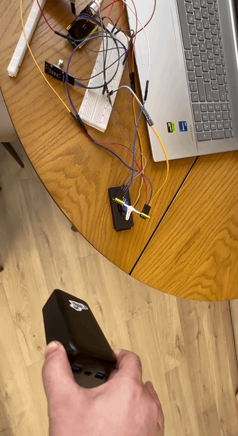

# Dual VL53L1X Target Tracker Radar (ESP32-S3)

Радар з автосупроводом цілі на двох ToF-датчиках VL53L1X і сервоприводі.  
ESP32-S3 · PlatformIO · Arduino · dual I2C · AUTO / MANUAL

---

## Demo

| AUTO | MANUAL |
|------|--------|
|  | див. [`media/manual-radar-control.mp4`](./media/manual-radar-control.mp4) |

Фото стенду: [`photo1.jpg`](./media/photo1.jpg), [`photo_2.jpg`](./media/photo_2.jpg), [`photo_3.jpg`](./media/photo_3.jpg)

---

## Що вміє

- **AUTO** — шукає ціль у секторі 50…130° і тримає її «по центру» за різницею дистанцій двох VL53L1X
- **MANUAL** — кут серви задається енкодером KY-040
- Перемикання режимів — кнопкою енкодера (Serial: `AUTO` / `MANUAL`)
- Два незалежні I2C-шини (`Wire` + `Wire1`) — без конфлікту адрес і без XSHUT
- Неблокуюча логіка на `millis()` (окрім debounce кнопки 150 ms)

---

## Hardware

| Компонент | Примітка |
|-----------|----------|
| ESP32-S3 DevKitC-1 | board у `platformio.ini` |
| 2× VL53L1X | Long range, timing budget 50 ms |
| Servo SG90 / MG90S | окреме 5 V + спільний GND з MCU |
| Encoder KY-040 | CLK / DT / SW |

### Pin map

| Функція | GPIO |
|---------|------|
| I2C #1 SDA / SCL (`Wire`) | 8 / 9 |
| I2C #2 SDA / SCL (`Wire1`) | 11 / 12 |
| Servo | 6 |
| Encoder CLK / DT / SW | 4 / 5 / 7 |

Адреси VL53L1X у прошивці не змінюються (дефолт 0x29): конфлікту немає, бо датчики на **різних шинах**.

---

## Алгоритм AUTO (коротко)

Ціль «в зоні», якщо дистанція **30…800 mm**.

1. **Обидва датчики бачать ціль** — якщо різниця дистанцій > 15%, серва кроком ±2° йде до ближчого; інакше тримає кут (clamp 20…160°)
2. **Лише один датчик** — крок ±10° у його бік
3. **Ніхто не бачить** — скан 50…130°, крок 2°, період ~15 ms

Це евристика за різницею ToF, **не PID** і не AHRS.

---

## Build & flash

```bash
pio run -e esp32-s3-devkitc-1
pio run -e esp32-s3-devkitc-1 -t upload
pio device monitor -b 115200
```

Залежності (`platformio.ini`):

- `pololu/VL53L1X`
- `madhephaestus/ESP32Servo`

---

## Stack

- MCU: ESP32-S3
- Framework: Arduino (PlatformIO)
- Sensors: 2× VL53L1X @ 100 kHz I2C
- Actuator: servo 50 Hz, pulse 500…2400 µs
- Input: rotary encoder + ISR на `CHANGE`

---

## Limitations / next

- Немає PID / фільтра / телеметрії з CRC
- У loop є `delay(150)` на debounce кнопки
- Один файл прошивки — далі варто рознести driver / tracker / UI

**Next (портфоліо):** PID по дистанції або куту, soft-fail при втраті ToF, бінарний UART-кадр з CRC, або dual-MCU (ESP32 сенсори → STM32 актуатор).

---

## Author

[MaxZorro-GG](https://github.com/MaxZorro-GG) · частина шляху до junior embedded (STM32 / sensors / control)

Виділено з [beetroot-homework](https://github.com/MaxZorro-GG/beetroot-homework) (`target-tracker-radar`). Оригінальний репозиторій курсу не змінювався.
